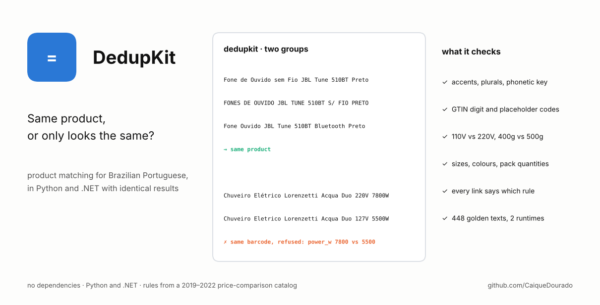
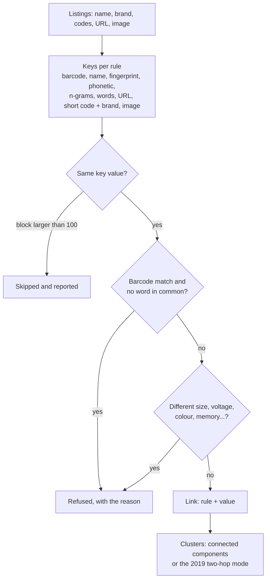
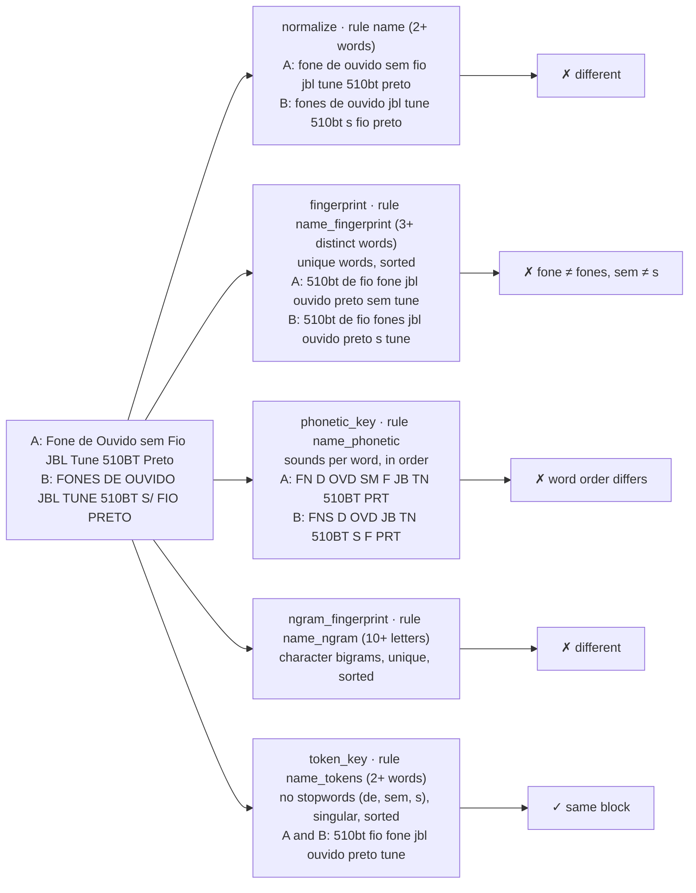
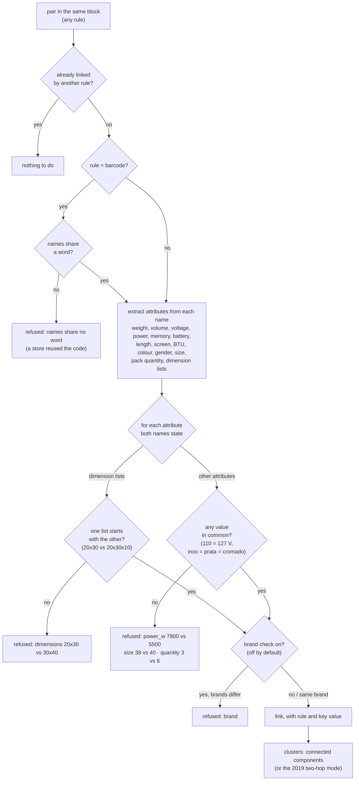

# DedupKit

[Português](README.pt-BR.md)

[](https://github.com/CaiqueDourado/DedupKit/actions/workflows/python.yml)
[](https://github.com/CaiqueDourado/DedupKit/actions/workflows/dotnet.yml)




Find listings that are the same product in Brazilian Portuguese data, and refuse the ones
that only look the same.

```text
Fone de Ouvido sem Fio JBL Tune 510BT Preto     ┐
FONES DE OUVIDO JBL TUNE 510BT S/ FIO PRETO     ├─ same product
Fone Ouvido JBL Tune 510BT Bluetooth Preto      ┘

Chuveiro Elétrico Lorenzetti Acqua Duo 220V 7800W  ┐ same barcode, refused:
Chuveiro Eletrico Lorenzetti Acqua Duo 127V 5500W  ┘ power_w: 7800 vs 5500
```

DedupKit is the matching logic of a 2019–2022 price-comparison catalog, rewritten as a
library, tested, and measured. It runs in **Python and .NET with identical results**: both
implementations are checked against the same 448 texts and 8 matching configurations in
[`testdata/golden.json`](testdata/golden.json). No dependencies in either language.

- **Text keys for Portuguese:** accent folding, OpenRefine-style fingerprints and character
  n-grams, plural reduction (`fogões` → `fogao`, `jardins` → `jardim`), a phonetic key
  (`xuveiro` = `chuveiro`, `caçarola` = `cassarola`), and URLs without tracking parameters.
- **Codes as stores fill them in:** GTIN check digit, placeholders (`SEM GTIN`, `0`, `7.89E+12`),
  long and short codes, and a blacklist of codes a store reuses for everything.
- **Attribute check:** two listings are never merged when their names state different measures
  (`400g` vs `500g`, `110V` vs `220V`, `20x30` vs `30x40`), memory, colours, gender, clothing or
  shoe sizes (`- 38 -` vs `- 40 -`) or pack quantities (`Kit 3 Pares` vs `Kit 6 Pares`). It knows that
  110 V and 127 V are the same Brazilian network and that inox, prata and cromado are one colour.
- **Audit trail:** every link records the rule and value that made it, and every refused pair says why.

## Install

```bash
pip install "dedupkit-br @ git+https://github.com/CaiqueDourado/DedupKit#subdirectory=python"
```

```bash
dotnet add package DedupKit   # once published; meanwhile reference dotnet/src/DedupKit
```

## Use

Python:

```python
from dedupkit_br import Record, match

records = [
    Record("1", "Fone de Ouvido sem Fio JBL Tune 510BT Preto", brand="JBL", codes=("6925281979309",)),
    Record("2", "FONES DE OUVIDO JBL TUNE 510BT S/ FIO PRETO", brand="JBL"),
    Record("5", "Chuveiro Elétrico Lorenzetti Acqua Duo 220V 7800W", codes=("7891129220911",)),
    Record("6", "Chuveiro Eletrico Lorenzetti Acqua Duo 127V 5500W", codes=("7891129220911",)),
]
result = match(records)
result.clusters      # [['1', '2']]
result.via["2"]      # ('name_tokens', '510bt fio fone jbl ouvido preto tune')
result.rejected[0]   # Rejected(a='5', b='6', rule='code', value='7891129220911', reason='power_w: 7800 vs 5500')
```

C#:

```csharp
using DedupKit;

var result = Matcher.Match(records);                       // same clusters, links and refusals
var strict = Matcher.Match(records, new MatchOptions { Rules = Rules.ByName("code", "name", "name_tokens", "url", "short_code_brand") });
```

Command line, on a CSV with a header row:

```bash
dedupkit-br match examples/listings.csv --brand brand --code code --url url --source source --rejected refused.csv > clusters.csv
```

The .NET sample does the same: `dotnet run --project dotnet/samples/MatchListings -- examples/listings.csv`.

The building blocks are public too:

| Python | C# | Example |
|---|---|---|
| `normalize` | `TextKeys.Normalize` | `"Pendente TLF-28, Preto!"` → `"pendente tlf 28 preto"` |
| `fingerprint` | `TextKeys.Fingerprint` | `"Preto Pendente preto"` → `"pendente preto"` |
| `token_key` | `TextKeys.TokenKey` | `"Fones de Ouvido s/ Fio"` → `"fio fone ouvido"` |
| `phonetic_key` | `TextKeys.PhoneticKey` | `"Xuveiro"` and `"Chuveiro"` → `"XVR"` |
| `normalize_url` | `TextKeys.NormalizeUrl` | `"https://www.Loja.com.br/p/12/?utm_source=x&id=3"` → `"loja.com.br/p/12?id=3"` |
| `attributes` | `ProductAttributes.Extract` | `"Ração 2,5kg"` → `{weight_kg: {2.5}}` |
| `conflict` | `ProductAttributes.Conflict` | `"110V"`, `"220V"` → `"voltage_v: 110 vs 220"` |
| `is_valid_gtin`, `code_class` | `Codes.IsValidGtin`, `Codes.Classify` | `"7891234567895"` → valid, `long` |

## What a decision looks like

Listings 5 and 6 of [`examples/listings.csv`](examples/listings.csv) share a barcode, so the `code` rule puts them
in one block; the attribute check finds different power and voltage, and the pair is refused with the reason.


Full JSON: [`docs/example-decision.json`](docs/example-decision.json), written by
[`scripts/make_json.py`](scripts/make_json.py) from what `match()`, `attributes()` and `conflict()` return.

## How it works



The exact rules, for both languages, are in [spec/ALGORITHMS.md](spec/ALGORITHMS.md).

### A name through each key

Each name rule turns the name into a key; listings with the same key fall in the same block. Two real ways of
writing the same headphones, and what each key makes of them (rule names in brackets, with the guard that keeps
short or empty keys out):



The other rules key on the barcode (long GTIN, and short code + brand), the URL without tracking parameters and the
image signature. A key shared by more than 100 listings (`max_block`) is skipped and reported: it is a placeholder,
not a product.

### Checking a pair

Two listings in the same block are only a candidate. This is what decides:



Every refusal is returned with its rule, key value and reason, so a wrong one can be traced to the line that made it.

## What each safeguard buys

Measured on 4,073 synthetic listings of 1,138 product variants with known answers
([`tools/synth_listings.py`](tools/synth_listings.py)). They imitate what made the real catalog hard:
stores writing names in their own style, sizes and colours of one product sharing a barcode or a photo,
reused SKUs, a "no photo" placeholder, the same page scraped twice.


| Configuration | Precision | Recall |
|---|---:|---:|
| The 2019 catalog: every key, two hops, fingerprint bug | 23.4% | 91.2% |
| Fingerprint fixed, barcode without the word check | 25.9% | 91.2% |
| + word check on barcodes | 44.4% | 91.2% |
| + attribute check (default) | 81.5% | 90.2% |
| + brand check | 87.6% | 90.2% |
| Recommended keys + attribute check | 89.9% | 85.1% |

Of 1,274 refused pairs, 6 were in fact the same product. Speed: about 41,000 listings in 13 seconds in Python.
Per-rule numbers are in [evaluation/results.md](evaluation/results.md); `python evaluation/evaluate.py` reproduces them.

Synthetic data gives exact answers but flatters any method built for it. So the defaults were also
checked on a real sample (next section), and one safeguard that looked good here, the brand check,
is off by default because real data broke it.

## On real data

[`evaluation/real_sample.py`](evaluation/real_sample.py) runs the attribute check on the 28,569 offers
of the [catalog's public sample](https://github.com/CaiqueDourado/brazilian-ecommerce-products),
grouped in 2019 into 4,030 groups. Without changing any parameter, **795 of those groups would be
split**. Pairs refused, by reason: clothing or shoe size 2,792, colour 721, length 330, dimension list 323,
pack quantity 267, volume 113, voltage 93, screen 43, memory 31, weight 25, power 9, and 41 barcode
matches whose names share no word. Most size refusals are the same shoe or garment in another size, which
the 2019 catalog kept on one page; DedupKit treats each size as its own product, as its barcode does.

| Rule | Listing A | Listing B | Why refused |
|---|---|---|---|
| code | Mass Way 2500 Baunilha 400g | Mass Way 2500 (500g) - Baunilha | weight 0.4 vs 0.5 kg |
| code | Squeeze Alumínio 500ml - Preto - Acte Sports | Squeeze Alumínio 750Ml - Preto - Acte Sports | volume 0.5 vs 0.75 l |
| code | Sutiã de Amamentação Preto Medela | Sutiã de Amamentação Branco Medela | colour |
| image | Toalheiro Elétrico A20 220v Emmeti | Toalheiro Elétrico A10 127v Emmeti | voltage 220 vs 127 |
| image | Pen Drive 32gb de Couro Branco com Argola ... | Pen Drive 4gb Personalizado de Couro Branco ... | memory 32 vs 4 GB |

Every one of these was a single product page in the old catalog. The full catalog (114.6 million offers, 18.3 million groups) is on [Kaggle](https://www.kaggle.com/datasets/caiquedourado/catalogo-produtos-ecommerce-brasil), if you want to run DedupKit at scale. The brand check, on the other
hand, refused 6,729 pairs in the same sample, mostly correct ones, because marketplaces fill the
brand field with the seller's name. Turn it on (`check_brands=True`) only when your brand field is clean.

### Checked pair by pair

The [product-matching pairs dataset](https://github.com/CaiqueDourado/product-matching-pairs-portuguese) has 780 candidate pairs from the catalog checked one by one at SKU level.
Merging every candidate, as the 2019 catalog did, gives 25% precision; DedupKit's word and attribute checks give
**47% precision at 91% recall**; adding a model-number check (TB125 vs TB112, PS3 vs PS4) gives 83% at 68%.
The 0.2.0 attribute rules (sizes, packs, dimension lists, 110 = 127 V) were written from the errors found in those pairs.

## Why these keys

In 2019, before writing the matching routine, the author computed about 15 keys for every distinct product name of the
catalog (five Soundex variants, three Metaphone variants, OpenRefine's fingerprint and n-gram, three token
fingerprints, a soft normalization, a hash, and the omission and skeleton keys of spelling correction), compared them
pair by pair ("same under A, different under B") and wrote the decisions in the SQL: use the token fingerprint
without stopwords, drop the variant that also split and sorted words ("too many false positives"). The keys DedupKit
ships are the survivors. [`evaluation/keys_benchmark.py`](evaluation/keys_benchmark.py) measures them again, with
the dropped ones that can be rebuilt, on the 715 decided pairs of the gold set and the 9,971 distinct names of the
catalog sample:

| Key | In DedupKit | Same-product pairs joined | Different-product pairs joined | Precision | Blocks | Largest block |
|---|:---:|---:|---:|---:|---:|---:|
| `normalize` | yes | 11 (7%) | 0 | 100% | 8,855 | 7 |
| `fingerprint` | yes | 16 (10%) | 1 | 94% | 8,448 | 20 |
| `token_key` | yes | 16 (10%) | 1 | 94% | 8,319 | 22 |
| `phonetic_key` | yes | 12 (7%) | 2 | 86% | 8,776 | 10 |
| `ngram_fingerprint` | yes | 13 (8%) | 0 | 100% | 8,759 | 8 |
| `fingerprint_2019` | no | 19 (12%) | 31 | 38% | 7,766 | 23 |
| `phonetic_no_digits` | no | 22 (13%) | 219 | 9% | 7,522 | 22 |
| `skeleton` | no | 36 (22%) | 254 | 12% | 6,726 | 36 |
| `skeleton_2019` | no | 23 (14%) | 219 | 10% | 7,474 | 21 |
| `omission` | no | 45 (27%) | 268 | 14% | 6,337 | 43 |

- **A name key alone finds few of these pairs**, and that is expected: the gold pairs were chosen hard (same barcode
  or photo, different wording). Name keys make blocks; the barcode, the photo and the attribute check do the rest.
- **Numbers are part of the product.** The phonetic key without numbers joins 219 different products (*Shampoo
  Aussie Moist 865ML* × *180 Ml*) to find 22 right ones.
- **Spelling-correction keys ignore words.** Omission and skeleton (Pollock and Zamora, via Talisman) keep each
  letter once, so unrelated names collide: omission put *Acabamento para Registro Gaveta… Deca* and *Bandagem Vollke
  Elastica Preta 5 Metros* in one key. The 2019 skeleton port also had a bug (its vowel part repeated the
  consonants): *DVD Canta Rio 98* and *Dvd - Centurião* both became `D/VCNTR/VCNTR`.
- **The every-other-word fingerprint** of 2019 joins 31 different-product pairs; the fixed one joins 1.
- Not rebuilt: the Soundex variants (a 1,100-line Portuguese phonetizer) and the hash; `phonetic_key` replaces the
  Metaphone variants.

These counterexamples are unit tests in both languages, with two known limits: *Hambúrguer* × *Hamburger* get
different phonetic keys (g × j before e), and broken encoding (*lav¨¢vel*) has to be repaired before matching
([PtBr.Text](https://github.com/CaiqueDourado/PtBr.Text) does it).

## The story

The catalog matched offers from dozens of stores with a SQL Server routine (2020–2022) over twelve
keys. It is published, read-only, in the catalog repository:
[legacy/agrupa_insere_grupos_produtos_similares.sql](https://github.com/CaiqueDourado/brazilian-ecommerce-products/tree/main/legacy).
Rewriting it showed what the numbers above measure:

- the name fingerprint was computed by a keyer that **kept every other word**, so different products
  could share a key (`legacy_fingerprint` reproduces it). The same keyer built `key_fingerprint` in the
  [Brazilian names dataset](https://github.com/CaiqueDourado/brazilian-names-surnames), where the bug is documented too,
  and grouped review clauses in 2020, where it joined "ótima qualidade" with "péssima qualidade"
  ([pros-e-contras-ptbr](https://github.com/CaiqueDourado/pros-e-contras-ptbr) now groups them with negation-safe keys);
- barcode matches were checked for a shared word only for long EANs, and nothing compared sizes or voltages,
  so sellers that reuse one barcode for a whole product line merged it into one page;
- the two-hop grouping depended on the order in which offers arrived (`mode="two_hop"` reproduces it;
  the default `connected` mode does not depend on order).

Image keys come from the 16×16 signature of the same catalog, now
[SimilarImageFinder](https://github.com/CaiqueDourado/SimilarImageFinder). Pass any image hash in `image`.

## Limits

- Written for Brazilian Portuguese product names. The text keys work on other Latin-alphabet text, but the
  stopwords, plurals, phonetic rules, colours and units are Portuguese.
- Rule-based and explainable, not learned. It will not know that "Galaxy S23" and "SM-S911B" are the same phone.
- All pairs inside a block are compared, so a block is capped at 100 records (`max_block`) and reported when skipped.
- The attribute check only sees what the name says. A listing that omits the size will match both sizes.

## Related

- [search-pattern-miner](https://github.com/CaiqueDourado/search-pattern-miner): turns search queries into patterns with the same stems and keys, from the same author.
- [google-keywords-dataset](https://github.com/CaiqueDourado/google-keywords-dataset): 38 million Google searches grouped into search patterns with stems and entity replacement, the same family of keys used here ([Kaggle](https://www.kaggle.com/datasets/caiquedourado/google-keywords-dataset)).
- [brazilian-ecommerce-products](https://github.com/CaiqueDourado/brazilian-ecommerce-products): the 114.6 million offers this matching grouped.
- [product-matching-pairs-portuguese](https://github.com/CaiqueDourado/product-matching-pairs-portuguese): labelled pairs to measure a matcher, with hard negatives.
- [fipe-ficha-tecnica-veiculos](https://github.com/CaiqueDourado/fipe-ficha-tecnica-veiculos): 25.5 million vehicle × product pairs matched by name alone, most of them wrong. It shows why the attribute check and the audit trail exist.
- [dicionario-portugues](https://github.com/CaiqueDourado/dicionario-portugues): 272 thousand Portuguese words with phonetic keys, rhymes and AI-generated texts ([Kaggle](https://www.kaggle.com/datasets/caiquedourado/dicionario-portugues)): Metaphone, fingerprint and n-gram keys for every word.

## Repository

| Path | Contents |
|---|---|
| `python/` | the `dedupkit-br` package (`import dedupkit_br`) and its tests |
| `dotnet/` | the `DedupKit` library, tests and a sample |
| `spec/ALGORITHMS.md` | the rules both implementations follow |
| `testdata/golden.json` | expected outputs, generated by `tools/make_testdata.py` |
| `tools/` | fold-table generator, synthetic listings, test-data generator |
| `evaluation/` | synthetic benchmark, real-sample check, key benchmark (`keys_benchmark.py`), figure |
| `examples/listings.csv` | the example above |

Credits for the ideas used are in [THIRD-PARTY-NOTICES.md](THIRD-PARTY-NOTICES.md).
Contributions: [CONTRIBUTING.md](CONTRIBUTING.md). MIT License.
