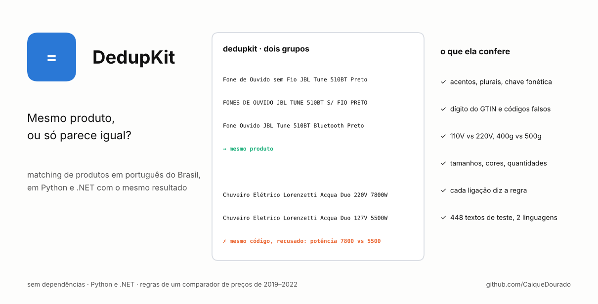
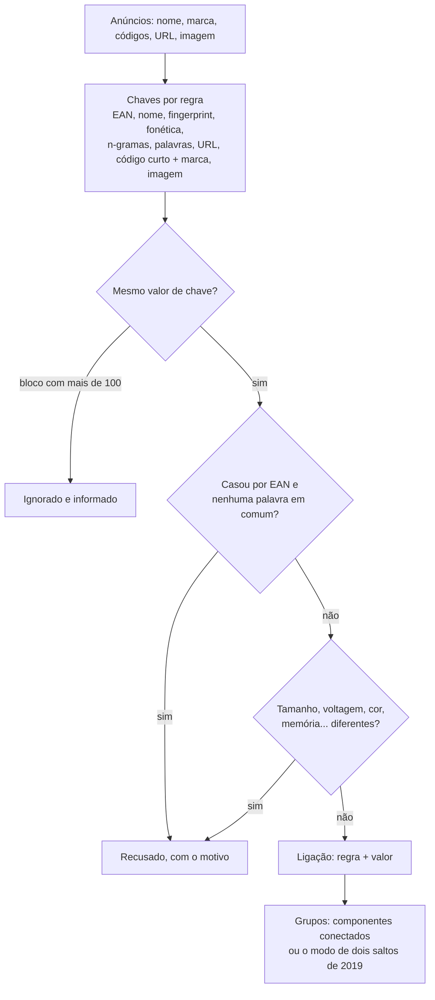
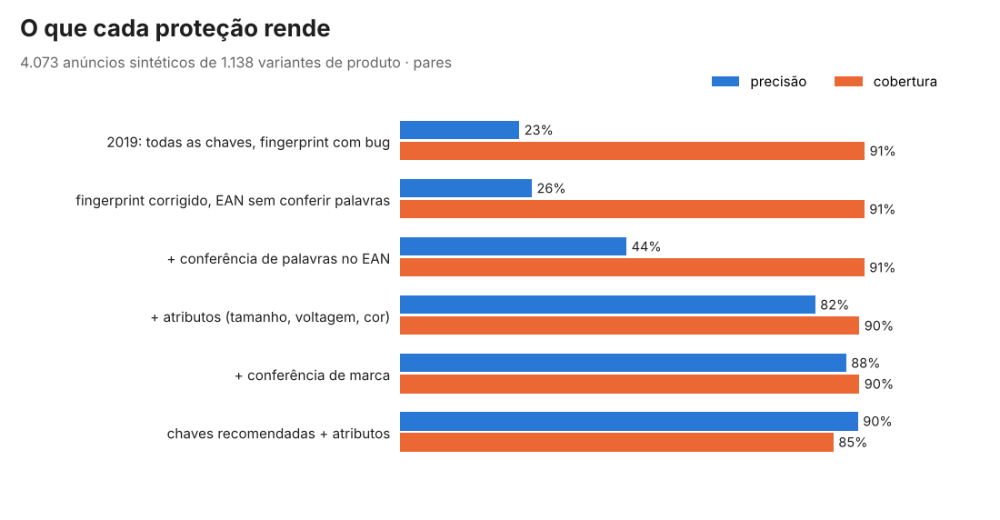

# DedupKit

[English](README.md)

[](https://github.com/CaiqueDourado/DedupKit/actions/workflows/python.yml)
[](https://github.com/CaiqueDourado/DedupKit/actions/workflows/dotnet.yml)




Encontra anúncios que são o mesmo produto em dados em português do Brasil, e recusa os que
só parecem iguais.

```text
Fone de Ouvido sem Fio JBL Tune 510BT Preto     ┐
FONES DE OUVIDO JBL TUNE 510BT S/ FIO PRETO     ├─ mesmo produto
Fone Ouvido JBL Tune 510BT Bluetooth Preto      ┘

Chuveiro Elétrico Lorenzetti Acqua Duo 220V 7800W  ┐ mesmo EAN, recusado:
Chuveiro Eletrico Lorenzetti Acqua Duo 127V 5500W  ┘ power_w: 7800 vs 5500
```

O DedupKit é a lógica de agrupamento de um catálogo comparador de preços (2019–2022), reescrita
como biblioteca, testada e medida. Roda em **Python e .NET com resultados idênticos**: as duas
versões são conferidas contra os mesmos 448 textos e 8 configurações de agrupamento em
[`testdata/golden.json`](testdata/golden.json). Nenhuma dependência nas duas linguagens.

- **Chaves de texto para português:** remoção de acentos, fingerprints no estilo OpenRefine e
  n-gramas de caracteres, redução de plural (`fogões` → `fogao`, `jardins` → `jardim`), chave
  fonética (`xuveiro` = `chuveiro`, `caçarola` = `cassarola`) e URLs sem parâmetros de rastreamento.
- **Códigos como as lojas preenchem:** dígito verificador do GTIN, valores de enchimento
  (`SEM GTIN`, `0`, `7.89E+12`), códigos longos e curtos e uma lista de códigos que uma loja usa para tudo.
- **Conferência de atributos:** dois anúncios nunca são juntados quando os nomes dizem medidas
  (`400g` vs `500g`, `110V` vs `220V`, `20x30` vs `30x40`), memórias, cores, gênero, tamanhos de roupa ou
  calçado (`- 38 -` vs `- 40 -`) ou quantidades (`Kit 3 Pares` vs `Kit 6 Pares`) diferentes. Ela sabe que
  110 V e 127 V são a mesma rede elétrica e que inox, prata e cromado são a mesma cor.
- **Trilha de auditoria:** cada ligação registra a regra e o valor que a criaram, e cada par recusado diz o motivo.

## Instalação

```bash
pip install "dedupkit-br @ git+https://github.com/CaiqueDourado/DedupKit#subdirectory=python"
```

```bash
dotnet add package DedupKit   # depois de publicado; até lá, referencie dotnet/src/DedupKit
```

## Uso

Python:

```python
from dedupkit_br import Record, match

records = [
    Record("1", "Fone de Ouvido sem Fio JBL Tune 510BT Preto", brand="JBL", codes=("6925281979309",)),
    Record("2", "FONES DE OUVIDO JBL TUNE 510BT S/ FIO PRETO", brand="JBL"),
    Record("5", "Chuveiro Elétrico Lorenzetti Acqua Duo 220V 7800W", codes=("7891129220911",)),
    Record("6", "Chuveiro Eletrico Lorenzetti Acqua Duo 127V 5500W", codes=("7891129220911",)),
]
result = match(records)
result.clusters      # [['1', '2']]
result.via["2"]      # ('name_tokens', '510bt fio fone jbl ouvido preto tune')
result.rejected[0]   # Rejected(a='5', b='6', rule='code', value='7891129220911', reason='power_w: 7800 vs 5500')
```

C#:

```csharp
using DedupKit;

var result = Matcher.Match(records);                       // mesmos grupos, ligações e recusas
var estrito = Matcher.Match(records, new MatchOptions { Rules = Rules.ByName("code", "name", "name_tokens", "url", "short_code_brand") });
```

Linha de comando, sobre um CSV com cabeçalho:

```bash
dedupkit-br match examples/listings.csv --brand brand --code code --url url --source source --rejected recusados.csv > grupos.csv
```

O exemplo em .NET faz o mesmo: `dotnet run --project dotnet/samples/MatchListings -- examples/listings.csv`.

As peças também são públicas:

| Python | C# | Exemplo |
|---|---|---|
| `normalize` | `TextKeys.Normalize` | `"Pendente TLF-28, Preto!"` → `"pendente tlf 28 preto"` |
| `fingerprint` | `TextKeys.Fingerprint` | `"Preto Pendente preto"` → `"pendente preto"` |
| `token_key` | `TextKeys.TokenKey` | `"Fones de Ouvido s/ Fio"` → `"fio fone ouvido"` |
| `phonetic_key` | `TextKeys.PhoneticKey` | `"Xuveiro"` e `"Chuveiro"` → `"XVR"` |
| `normalize_url` | `TextKeys.NormalizeUrl` | `"https://www.Loja.com.br/p/12/?utm_source=x&id=3"` → `"loja.com.br/p/12?id=3"` |
| `attributes` | `ProductAttributes.Extract` | `"Ração 2,5kg"` → `{weight_kg: {2.5}}` |
| `conflict` | `ProductAttributes.Conflict` | `"110V"`, `"220V"` → `"voltage_v: 110 vs 220"` |
| `is_valid_gtin`, `code_class` | `Codes.IsValidGtin`, `Codes.Classify` | `"7891234567895"` → válido, `long` |

## Como funciona



As regras exatas, para as duas linguagens, estão em [spec/ALGORITHMS.md](spec/ALGORITHMS.md) (em inglês).

## O que cada proteção rende

Medido em 4.073 anúncios sintéticos de 1.138 variantes de produto com resposta conhecida
([`tools/synth_listings.py`](tools/synth_listings.py)). Eles imitam o que tornava o catálogo real difícil:
cada loja escrevendo o nome do seu jeito, tamanhos e cores de um produto dividindo o mesmo EAN ou a mesma foto,
SKUs reaproveitados, a imagem "sem foto", a mesma página coletada duas vezes.



| Configuração | Precisão | Cobertura |
|---|---:|---:|
| O catálogo de 2019: todas as chaves, dois saltos, bug do fingerprint | 23,4% | 91,2% |
| Fingerprint corrigido, EAN sem conferir palavras | 25,9% | 91,2% |
| + conferência de palavras no EAN | 44,4% | 91,2% |
| + conferência de atributos (padrão) | 81,5% | 90,2% |
| + conferência de marca | 87,6% | 90,2% |
| Chaves recomendadas + atributos | 89,9% | 85,1% |

Dos 1.274 pares recusados, 6 eram de fato o mesmo produto. Velocidade: cerca de 41 mil anúncios em 13 segundos em Python.
Os números por regra estão em [evaluation/results.md](evaluation/results.md); `python evaluation/evaluate.py` os reproduz.

Dados sintéticos dão respostas exatas, mas favorecem qualquer método feito para eles. Por isso os padrões também
foram conferidos numa amostra real (próxima seção), e uma proteção que parecia boa aqui, a de marca, vem
desligada porque os dados reais a derrubaram.

## Em dados reais

[`evaluation/real_sample.py`](evaluation/real_sample.py) roda a conferência de atributos sobre as 28.569 ofertas
da [amostra pública do catálogo](https://github.com/CaiqueDourado/catalogo-produtos-ecommerce-brasil),
agrupadas em 2019 em 4.030 grupos. Sem mudar nenhum parâmetro, **795 desses grupos seriam divididos**.
Pares recusados, por motivo: tamanho de roupa ou calçado 2.792, cor 721, comprimento 330, lista de dimensões 323,
quantidade 267, volume 113, voltagem 93, tela 43, memória 31, peso 25, potência 9, e 41 casamentos por EAN cujos
nomes não têm nenhuma palavra em comum. A maior parte das recusas por tamanho é o mesmo calçado ou roupa em outro
tamanho, que o catálogo de 2019 deixava numa página só; o DedupKit trata cada tamanho como um produto, como faz o EAN.

| Regra | Anúncio A | Anúncio B | Motivo da recusa |
|---|---|---|---|
| code | Mass Way 2500 Baunilha 400g | Mass Way 2500 (500g) - Baunilha | peso 0,4 vs 0,5 kg |
| code | Squeeze Alumínio 500ml - Preto - Acte Sports | Squeeze Alumínio 750Ml - Preto - Acte Sports | volume 0,5 vs 0,75 l |
| code | Sutiã de Amamentação Preto Medela | Sutiã de Amamentação Branco Medela | cor |
| image | Toalheiro Elétrico A20 220v Emmeti | Toalheiro Elétrico A10 127v Emmeti | voltagem 220 vs 127 |
| image | Pen Drive 32gb de Couro Branco com Argola ... | Pen Drive 4gb Personalizado de Couro Branco ... | memória 32 vs 4 GB |

No catálogo antigo, cada um desses pares era uma única página de produto. O catálogo completo (114,6 milhões de ofertas, 18,3 milhões de grupos) está no [Kaggle](https://www.kaggle.com/datasets/caiquedourado/catalogo-produtos-ecommerce-brasil), para rodar o DedupKit em escala. Já a conferência de marca recusou
6.729 pares na mesma amostra, a maioria corretos, porque os marketplaces preenchem o campo marca com o nome
do vendedor. Ligue (`check_brands=True`) só quando o seu campo de marca for limpo.

### Conferido par a par

O [dataset de pares para matching](https://github.com/CaiqueDourado/pares-matching-produtos-ptbr) tem 780 pares candidatos do catálogo conferidos um a um, no nível de SKU.
Juntar todo candidato, como fazia o catálogo de 2019, dá 25% de precisão; as conferências de palavra e atributos do
DedupKit dão **47% de precisão com 91% de cobertura**; somando uma conferência de número de modelo (TB125 × TB112,
PS3 × PS4), 83% com 68%. As regras de atributos da 0.2.0 (tamanhos, quantidades, listas de dimensões, 110 = 127 V)
foram escritas a partir dos erros encontrados nesses pares.

## A história

O catálogo juntava ofertas de dezenas de lojas com uma rotina em SQL Server (2020–2022) sobre doze
chaves. Ela está publicada, só para leitura, no repositório do catálogo:
[legacy/agrupa_insere_grupos_produtos_similares.sql](https://github.com/CaiqueDourado/catalogo-produtos-ecommerce-brasil/tree/main/legacy).
Reescrevê-la mostrou o que os números acima medem:

- o fingerprint do nome era calculado por uma função que **mantinha uma palavra sim, outra não**, então
  produtos diferentes podiam ter a mesma chave (`legacy_fingerprint` reproduz isso). A mesma função gerou o
  `key_fingerprint` da [base de nomes e sobrenomes](https://github.com/CaiqueDourado/nomes-e-sobrenomes-brasil), onde o bug também está documentado,
  e agrupou as cláusulas dos reviews em 2020, juntando "ótima qualidade" com "péssima qualidade"
  (a [pros-e-contras-ptbr](https://github.com/CaiqueDourado/pros-e-contras-ptbr) agora agrupa com chaves que respeitam a negação);
- casamentos por EAN só conferiam palavra em comum para EANs longos, e nada comparava tamanho ou voltagem,
  então vendedores que usam um EAN para a linha inteira juntavam tudo numa página só;
- o agrupamento em dois saltos dependia da ordem em que as ofertas chegavam (`mode="two_hop"` reproduz;
  o modo padrão `connected` não depende da ordem).

As chaves de imagem vêm da assinatura 16×16 do mesmo catálogo, hoje
[SimilarImageFinder](https://github.com/CaiqueDourado/SimilarImageFinder). Passe qualquer hash de imagem em `image`.

## Limites

- Feito para nomes de produto em português do Brasil. As chaves de texto funcionam em outros textos em alfabeto
  latino, mas stopwords, plurais, regras fonéticas, cores e unidades são do português.
- Baseado em regras e explicável, não aprendido. Não vai saber que "Galaxy S23" e "SM-S911B" são o mesmo celular.
- Todos os pares de um bloco são comparados, então um bloco tem no máximo 100 registros (`max_block`) e é informado quando ignorado.
- A conferência de atributos só vê o que o nome diz. Um anúncio que omite o tamanho casa com os dois tamanhos.

## Relacionados

- [catalogo-produtos-ecommerce-brasil](https://github.com/CaiqueDourado/catalogo-produtos-ecommerce-brasil): as 114,6 milhões de ofertas que este agrupamento juntou.
- [pares-matching-produtos-ptbr](https://github.com/CaiqueDourado/pares-matching-produtos-ptbr): pares rotulados para medir um matcher, com negativos difíceis.
- [fipe-ficha-tecnica-veiculos](https://github.com/CaiqueDourado/fipe-ficha-tecnica-veiculos): 25,5 milhões de pares veículo × produto casados só pelo nome, a maioria errada. Mostra por que a conferência de atributos e a trilha de auditoria existem.

## Repositório

| Caminho | Conteúdo |
|---|---|
| `python/` | o pacote `dedupkit-br` (`import dedupkit_br`) e seus testes |
| `dotnet/` | a biblioteca `DedupKit`, testes e um exemplo |
| `spec/ALGORITHMS.md` | as regras que as duas versões seguem |
| `testdata/golden.json` | saídas esperadas, geradas por `tools/make_testdata.py` |
| `tools/` | gerador da tabela de acentos, anúncios sintéticos, gerador dos dados de teste |
| `evaluation/` | benchmark sintético, conferência na amostra real, figura |
| `examples/listings.csv` | o exemplo acima |

Créditos das ideias usadas em [THIRD-PARTY-NOTICES.md](THIRD-PARTY-NOTICES.md).
Contribuições: [CONTRIBUTING.md](CONTRIBUTING.md). Licença MIT.
